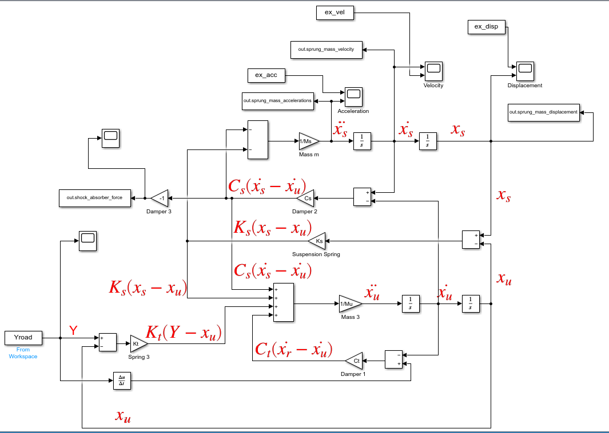
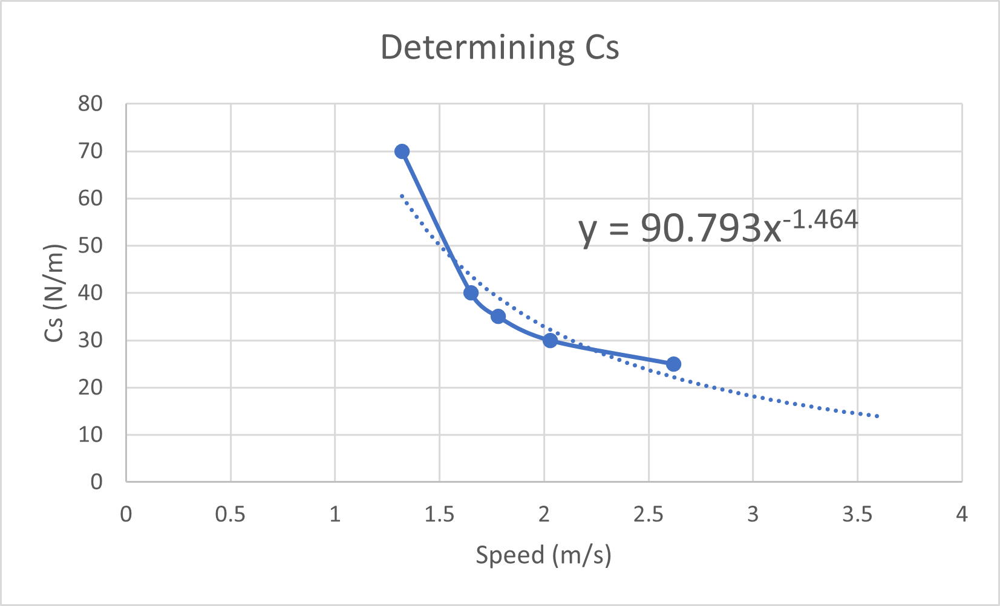
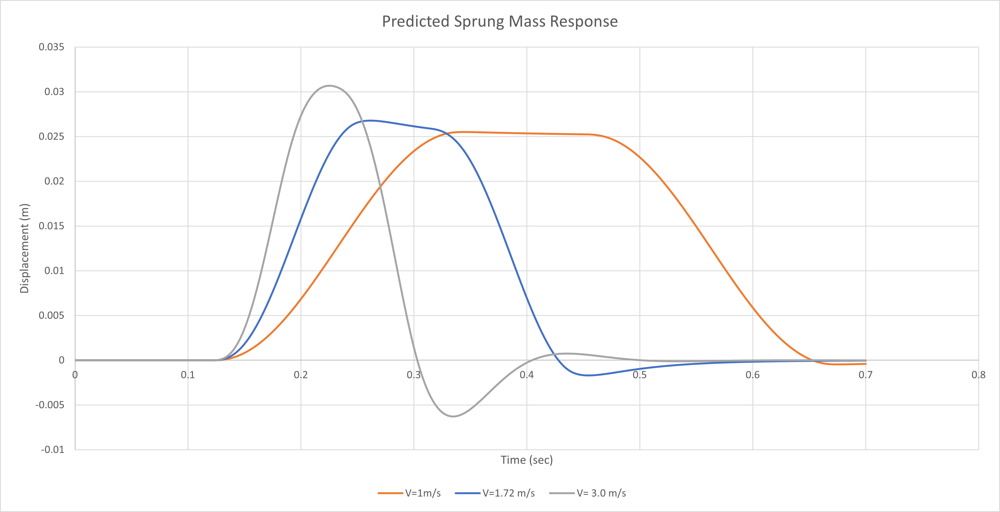

# Quarter-Car Suspension Model: Calibration and Prediction

A quarter-car suspension model in Simulink, calibrated against video-tracked tests of a small suspension rig driven over a bump, then used to predict the rig's response at new speeds.

Design Assignment 2 for ME 780: Design of a Mechatronics System at the University of Waterloo, Winter 2021, completed as Group 8. The model, rig data and damping fit were shared group work; the response paper's Q2–Q4 answers were completed individually.

## The model

Two masses, the sprung body (`Ms` = 0.435 kg) and the unsprung wheel (`Mu` = 0.119 kg), are linked by the suspension spring and damper (`Ks`, `Cs`) and sit on the tire, modelled as a second spring and damper (`Kt`, `Ct`) over the road input `Y`. Each gain block is one term of the two equations of motion, which the diagram labels in red.

The road is a 25 mm haversine bump up, a 116 mm flat, and a haversine back down, generated in time for each test speed by the script.

## Calibration

The rig was filmed at 1.32, 1.65, 1.78, 2.03 and 2.62 m/s, and the sprung mass was tracked frame by frame (the slow-motion video runs at 1/3 real time, which the scripts correct for). For each speed the simulated displacement, velocity and acceleration were overlaid on the tracked data and `Cs` was tuned until they matched.

No single damping constant fit every speed. The calibrated values fell from 70 Ns/m at 1.32 m/s to 25 Ns/m at 2.62 m/s, and a power law fits them:

**Cs = 90.793 · v^-1.464**

## Prediction

With `Cs` set from that fit, the model predicted the response over the same bump at 1.00, 1.72 and 3.00 m/s:

| Case | Peak x_s [mm] | Overshoot | Rise time [ms] | Peak time [ms] | Peak accel. [m/s²] |
|---|---|---|---|---|---|
| Predicted, 1.00 m/s | 25.5 | 102.0% | 123.2 | 220 | −2.7 |
| Predicted, 1.72 m/s | 26.8 | 107.1% | 68.4 | 140 | 7.1 |
| Predicted, 3.00 m/s | 30.7 | 122.7% | 41.4 | 106 | 16.2 |
| Experimental, 1.32 m/s | 24.9 | 99.5% | 100.0 | 180 | 4.9 |
| Experimental, 1.65 m/s | 26.5 | 105.9% | 82.0 | 145 | 6.9 |
| Experimental, 1.78 m/s | 26.0 | 104.0% | 77.0 | 133 | 4.2 |
| Experimental, 2.03 m/s | 27.4 | 109.5% | 68.0 | 136 | 5.9 |
| Experimental, 2.62 m/s | 29.5 | 118.0% | 56.0 | 116 | 18.3 |

Peak displacement, overshoot, rise time and peak time follow the experimental trend with speed. Peak acceleration is the weakest match, especially at low speed.

## Repository layout

| Path | Contents |
|---|---|
| `template/` | Base model, run script and the standalone road-profile generator |
| `calibration/<speed>-mps/` | One self-contained case per test speed: model, script and tracked data |
| `prediction/` | Model and script using the speed-dependent `Cs` fit |
| `data/Cs Aggregate.xlsx` | Calibrated `Cs` per speed, the power-law fit, and simulated vs experimental response plots |
| `data/Prediction Cases.xlsx` | Tracked data for all five speeds side by side |
| `docs/DA2_Response_Paper.docx` | The response paper |

## Running it

Requires MATLAB and Simulink (saved in R2020a/R2020b). In any case folder:

1. Run `Quart_Car_Script.m`. It sets the parameters, reads the tracked data and builds the road profile `Yroad`.
2. Open and run `Quart_Car_Model_3.slx` (0.7 s). The scopes overlay simulated and tracked displacement, velocity and acceleration.

For the prediction cases, set `vel` in `prediction/Quart_Car_Script.m` to 1.00, 1.72 or 3.00. That folder's tracked-data overlay is the 1.32 m/s run, kept for reference only.

## Limitations and notes

- Only `Cs` is speed-dependent. In a real suspension linkage the effective spring rate also changes with geometry, so `Ks` should vary too.
- The scripts use `Ks` = 635 N/m, while the response paper's parameter table lists 653 N/m. The scripts are left as they ran.
- The 2.62 m/s case also overlays a 12th-order polynomial fit of the tracked data to smooth out tracking noise.

## Changes since submission

The submission as handed in is tagged `v2021-original`. Since then:

- The files were reorganised into the folders above, and duplicate copies of the data were removed.
- The 1.32 and 1.65 m/s scripts still held a trial value of `Cs = 100`. They now use the calibrated 70 and 40 Ns/m that the fit was built from.
- The damping units in `Cs Aggregate.xlsx` were corrected from N/m to Ns/m. The image of that chart above predates the fix.
- The paper's embedded copy of the model was removed, since the same files are in `prediction/`.
- Simulink caches (`slprj/`, `.slxc`) are not tracked.

---

Published for portfolio viewing. No license to reuse it is granted.
